# P, PD, PI and PID steering control: a simulation study

**Question.** When a car has to follow a path, what does each part of a PID controller buy,
what do the gains kp, ki and kd do, and what has to be added before the controller works on
something closer to a real car than a textbook model?

**How it was studied.** A small Ackermann car (wheelbase 0.3 m, steering limit 30 degrees,
0.6 m/s) is steered along a path by one PID implementation with the unused gains set to zero
for P, PD and PI. Roughly 9,000 simulated runs were made in a fast Python model with servo lag,
delay, sensor noise and a steering offset, and the tuned controllers were then driven round the
cone track in Gazebo.

## Summary of findings

1. **Which controller wins depends on what error you feed it.** Steering on the distance from
   the path (cross-track error), P and PI never worked: 0 of 20 laps finished for any gain
   tried. PD and PID finished all 20. Steering on the heading to a point 0.5 m ahead, plain P
   was already the best of the four.
2. **D is what makes cross-track control stable.** The car's sideways position responds to
   steering like a mass with no friction, so P alone swings back and forth for ever. Adding D
   took the step response from "never settles" to settled in 3.95 s with no overshoot.
3. **I removes steady errors, slowly, and costs overshoot.** With a 3 degree steering offset
   PD stayed 17.5 mm off the path for ever; PID brought that to 2.5 mm after 25 s. In a
   constant turn PD sat 50 mm inside the path and PID 6 mm. On the twisty cone track the
   integral did not help: PID 33 mm RMS error against 28 mm for PD.
4. **Where the D term gets its derivative matters more than its gain.** Differencing the noisy
   position gave 310 mm RMS error and a steering command pinned at its limit 89 % of the time.
   The best filter brought that to 69 mm. Taking the rate from the heading instead gave 28 mm
   with no filter at all.
5. **Anti-windup is not optional.** Without it the same PID overshot 23 % instead of 7.5 % and
   took 12.3 s instead of 3.3 s to settle after a large offset.
6. **This explains the earlier Gazebo runs of `p_controller`, `pd_controller` and
   `pi_controller`.** Aiming at a point ahead is already PD control in disguise, so their P
   term did most of the work, their raw D term mostly amplified noise, and their I term had no
   steady error to remove.

7. **The pattern held in Gazebo, with larger errors.** On the cone track in Gazebo, P and PI
   on cross-track error came to a stop off the path in all 3 runs. PD (52 mm RMS), PID (59 mm)
   and look-ahead P (51 mm) finished all 3. The errors were about twice what the Python model
   predicted, and look-ahead P tied with PD instead of beating it.

## 1. What is being controlled

The car is the kinematic bicycle model in `controls_pkg/bicycle_model.py`: rear-axle position
(x, y), heading, speed, and a front steering angle limited to 30 degrees and 180 degrees per
second. Its tightest turn is L / tan(30 degrees) = 0.52 m. The controller outputs one number,
the steering angle; speed is held at 0.6 m/s by a separate loop.

Two tracks are used. The cone track is the one in `sim_pkg` (also used in Gazebo); its tightest
corner is at the car's turning limit. The race track has long straights and wide constant turns, and was kept out
of the tuning so that it tests the result on a track the gains were not fitted to.

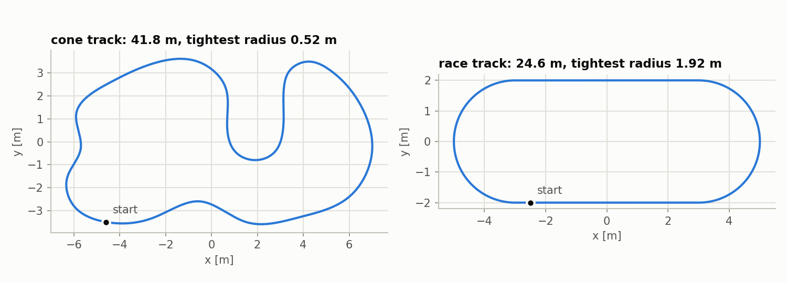

A PID needs a single error to act on. Two choices are compared throughout:

| Error signal | Definition | Unit |
|---|---|---|
| **Cross-track error** | minus the signed distance from the rear axle to the nearest path point | m |
| **Look-ahead heading error** | angle between the car's heading and the direction to the path point 0.5 m ahead | rad |

They behave very differently, and the difference is the main result of the study. For
cross-track error $e$ at speed $v$, with small angles:

$$\ddot e = -\frac{v^2}{L}\,\delta$$

Steering $\delta$ sets the *acceleration* of the error. Nothing in the car pulls the error back
or slows it down, so all the damping has to come from the controller. With $v$ = 0.6 m/s and
$L$ = 0.3 m the factor $v^2/L$ is 1.2.

## 2. The controller

For an error $e$ sampled every $\Delta t$ seconds:

$$u = k_p\,e + k_i \sum e\,\Delta t + k_d\,\dot e$$

| Term | What it reacts to | What it is for |
|---|---|---|
| P, $k_p e$ | the error now | pushes toward the path, harder when further away |
| I, $k_i \sum e\,\Delta t$ | the error added up over time | keeps pushing until a steady error is gone |
| D, $k_d \dot e$ | how fast the error is changing | brakes the approach, so the car does not overshoot |

The implementation is `controls_pkg/pid.py` (about 50 lines of logic, unit-tested in
`test/test_pid.py`). It has three additions that section 7 tests one at a time:

- **Derivative filter.** The D term passes through a first-order low-pass with time constant
  `tau`.
- **Measured rate.** The D term can use a rate supplied by the caller instead of differencing
  the error. For cross-track error the rate is $-v \sin(\text{heading error})$, which needs the
  heading and not the noisy position.
- **Anti-windup.** The integral stops growing while the output is at the steering limit and
  the error is pushing it further.

It also returns zero derivative on the first sample (there is no previous error to difference)
and ignores samples with a time step of zero or less.

## 3. Making the simulation realistic

A textbook loop has a perfect sensor and an instant actuator. Each item below was added
because it changes which gains work. All are in `controls_pkg/pid_sim.py`.

| Effect | Value | Why it matters |
|---|---|---|
| Steering limit | 30 degrees | large errors saturate the command; the integral must cope (section 7.2) |
| Steering rate limit | 180 degrees/s | the wheel cannot follow a command that jumps |
| Servo lag | 80 ms first-order | the wheel angle trails the command, which removes damping |
| Command delay | 50 ms (one control period) | same effect as lag; section 7.3 varies it |
| Sample rate | 20 Hz controller, 200 Hz plant | the controller only acts every 50 ms |
| Position noise | 30 mm standard deviation per sample | from `noise.py`; this is what breaks a differenced D term |
| Heading noise | 0.02 rad standard deviation per sample | from `noise.py` |
| Steering trim | 2 degrees constant offset | a disturbance the controller cannot see, as on any real car |

Tracking error is always computed from the true position, never from the noisy one the
controller sees. Runs with noise are repeated over several random seeds and reported as mean
and standard deviation.

Not modelled: tyre slip, weight transfer, and the car's mass. Those are in Gazebo, which is why
section 9 repeats the comparison there.

## 4. Method

**Tests.** Each controller is put through the same four:

1. *Step response:* start 0.5 m to the side of a straight line, perfect sensors. This shows
   speed, overshoot and settling.
2. *Disturbance:* drive a straight line; at 5 s a 3 degree steering trim appears.
3. *Constant turn:* a circle of radius 1.5 m, which needs a constant 11 degrees of steering.
4. *Noisy laps:* full laps of both tracks with sensor noise and a 2 degree trim, 20 seeds.

**Measurements.**

| Metric | Meaning |
|---|---|
| Rise time | time for the error to fall from 90 % to 10 % of the starting offset |
| Overshoot | how far the car goes past the path, as a percentage of the starting offset |
| Settling time | time after which the error stays within 5 % of the starting offset |
| RMS / max error | root-mean-square and largest distance from the path over a lap |
| Steering effort | RMS rate of change of the steering command, in degrees per second |
| Saturated | share of the time the command sits at the 30 degree limit |

**Tuning.** A comparison is only fair if each controller is at its own best setting, so every
type was tuned by the same grid search, separately for each error signal. A setting qualifies
if it completes three noisy runs (step, circle, cone lap) and meets three design
specifications:

- step overshoot at most 10 %,
- step settling time at most 4 s,
- steering effort at most 180 degrees/s, the servo's slew rate. Asking for more than the servo
  can deliver only wears it out.

Among the settings that qualify, the one with the lowest RMS error on the noisy runs is used.

<!-- BEGIN tuning -->
| error signal | type | settings tried | complete all runs | also meet the specs | kp | ki | kd | tau [s] | RMS error [m] | effort [deg/s] | overshoot [%] | settling [s] |
|---|---|---|---|---|---|---|---|---|---|---|---|---|
| cross-track error | P | 8 | 0 | 0 |  |  |  |  | n/a | n/a | n/a | n/a |
| cross-track error | PD | 168 | 154 | 11 | 3.00 | 0.00 | 4.00 | 0.10 | 0.058 | 152 | 0.0 | 3.95 |
| cross-track error | PI | 48 | 0 | 0 |  |  |  |  | n/a | n/a | n/a | n/a |
| cross-track error | PID | 1008 | 856 | 10 | 3.00 | 0.25 | 3.00 | 0.10 | 0.052 | 150 | 4.1 | 2.65 |
| look-ahead heading error | P | 7 | 7 | 2 | 1.00 | 0.00 | 0.00 | 0.00 | 0.045 | 107 | 6.0 | 3.10 |
| look-ahead heading error | PD | 105 | 105 | 11 | 1.00 | 0.00 | 0.05 | 0.50 | 0.045 | 116 | 4.5 | 2.05 |
| look-ahead heading error | PI | 35 | 35 | 6 | 1.50 | 0.10 | 0.00 | 0.00 | 0.063 | 160 | 0.0 | 2.20 |
| look-ahead heading error | PID | 525 | 525 | 37 | 1.50 | 0.10 | 0.05 | 0.30 | 0.064 | 176 | 0.0 | 2.25 |
<!-- END tuning -->

Three things to read from this table:

- For cross-track error **no P or PI setting completed the runs**, at any gain. In the rest of
  the report P and PI on cross-track error are shown with the kp (and ki) of the tuned PD and
  PID, so the plots show what removing the D term does.
- For look-ahead heading error the search chose the **smallest kd and ki it was offered**, and
  the settings with an integral scored worse than plain P (0.063 m against 0.045 m). The
  search is saying these terms are not wanted there.
- The effort limit is what stops kp from going higher. Position noise passes straight through
  the P term: effort is 149 degrees/s at kp = 3 and 281 at kp = 6 (section 6).

## 5. Results: P, PD, PI and PID compared

### 5.1 Step response

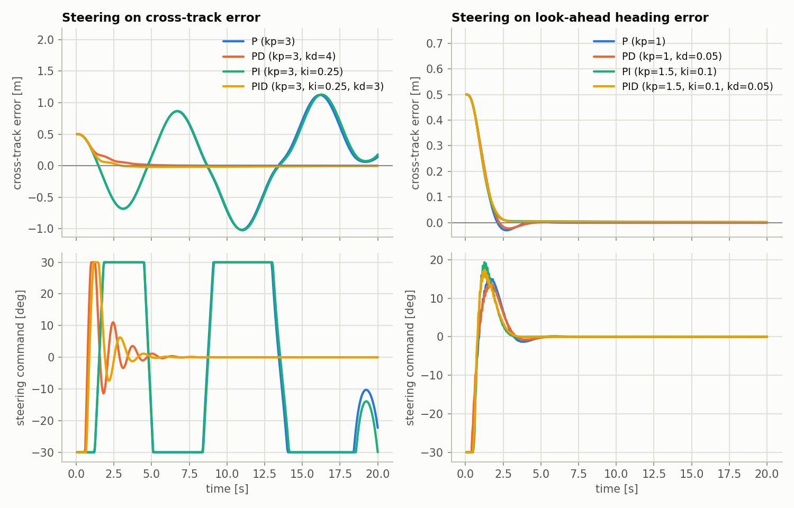

<!-- BEGIN step -->
| error signal | controller | rise time [s] | overshoot [%] | settling time [s] | largest error [m] |
|---|---|---|---|---|---|
| cross-track error | P (kp=3) | 0.85 | 203.4 | n/a | 1.12 |
| cross-track error | PD (kp=3, kd=4) | 2.70 | 0.0 | 3.95 | 0.50 |
| cross-track error | PI (kp=3, ki=0.25) | 0.85 | 204.8 | n/a | 1.13 |
| cross-track error | PID (kp=3, ki=0.25, kd=3) | 1.65 | 4.1 | 2.65 | 0.50 |
| look-ahead heading error | P (kp=1) | 1.30 | 6.0 | 3.10 | 0.50 |
| look-ahead heading error | PD (kp=1, kd=0.05) | 1.35 | 4.5 | 2.05 | 0.50 |
| look-ahead heading error | PI (kp=1.5, ki=0.1) | 1.35 | 0.0 | 2.20 | 0.50 |
| look-ahead heading error | PID (kp=1.5, ki=0.1, kd=0.05) | 1.45 | 0.0 | 2.25 | 0.50 |
<!-- END step -->

On cross-track error, P and PI (their curves overlap) swing to more than twice the starting
offset on the far side and never settle; the steering spends most of the time against its
limit. This is the frictionless-mass behaviour from section 1: the P term pulls the car to the
path, but nothing slows it as it arrives. PD settles in 3.95 s with no overshoot. PID is faster
to arrive (rise time 1.65 s against 2.70 s) because the search gave it a smaller kd, and pays
with 4.1 % overshoot from the integral that built up on the way in.

On look-ahead heading error all four settle within about 3 s and look alike. Section 8
explains why P alone is enough here.

### 5.2 A disturbance appears

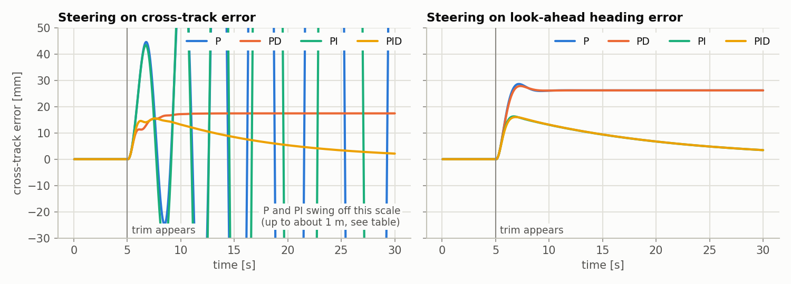

<!-- BEGIN disturbance -->
| error signal | type | peak error [mm] | final error [mm] | final ripple [mm] |
|---|---|---|---|---|
| cross-track error | P | 860.8 | -370.9 | 1214.1 |
| cross-track error | PD | 17.5 | 17.5 | 0.0 |
| cross-track error | PI | 973.6 | -642.2 | 990.0 |
| cross-track error | PID | 15.6 | 2.5 | 0.7 |
| look-ahead heading error | P | 28.6 | 26.2 | 0.0 |
| look-ahead heading error | PD | 27.9 | 26.2 | 0.0 |
| look-ahead heading error | PI | 16.3 | 3.8 | 0.8 |
| look-ahead heading error | PID | 16.0 | 3.8 | 0.8 |
<!-- END disturbance -->

A steering trim of 3 degrees (0.052 rad) can only be cancelled by an equal and opposite
command. A controller without an integral can only produce that command from a standing error:
$k_p e = 0.052$ gives $e$ = 17.5 mm for kp = 3, which is what PD shows. The integral keeps
growing until it supplies the 3 degrees by itself, so PID's error goes to zero. It does so
slowly, 2.5 mm left after 25 s, because the tuned ki is small; section 6 shows the trade.

The look-ahead controllers show the same pattern: P and PD keep a 26 mm offset, PI and PID
bring it down to 4 mm in the same time.

### 5.3 A constant turn

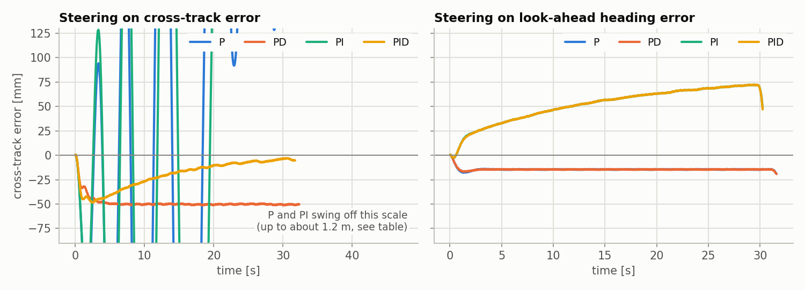

<!-- BEGIN circle -->
| error signal | type | completed | steady error [mm] | ripple [mm] |
|---|---|---|---|---|
| cross-track error | P | no | 583.1 | 1044.5 |
| cross-track error | PD | yes | -50.3 | 2.0 |
| cross-track error | PI | no | 585.9 | 1039.1 |
| cross-track error | PID | yes | -5.7 | 6.1 |
| look-ahead heading error | P | yes | -14.7 | 4.8 |
| look-ahead heading error | PD | yes | -14.7 | 5.2 |
| look-ahead heading error | PI | yes | 69.1 | 24.2 |
| look-ahead heading error | PID | yes | 69.1 | 25.5 |
<!-- END circle -->

A turn is a disturbance that lasts as long as the turn does. On cross-track error PD runs
50 mm inside the path, again because it needs an error to hold the steering angle; PID brings
that to 6 mm by the end of two laps.

On look-ahead heading error the integral makes the turn **worse**: P holds 15 mm, PI drifts to
69 mm and is still drifting. The reason is geometric. The integral drives the look-ahead angle
to zero, but in a turn the car is on the path exactly when that angle is *not* zero, because
the point ahead is round the bend. Integral action only helps when zero error means the car is
where it should be.

### 5.4 Noisy laps

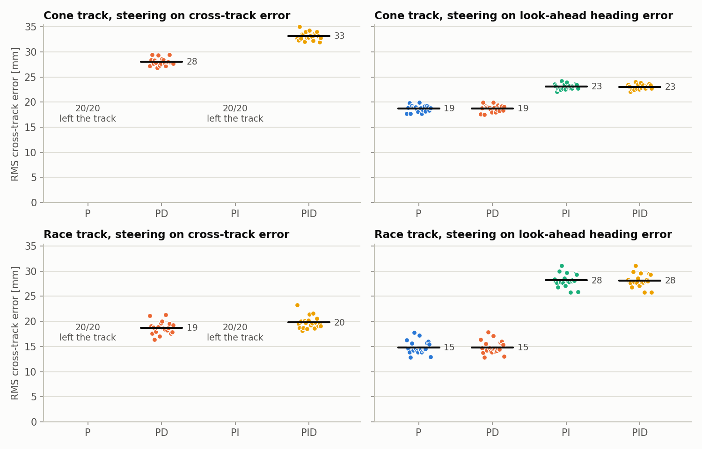

<!-- BEGIN laps -->
| track | error signal | type | laps finished | RMS error [mm] | sd | max error [mm] | effort [deg/s] | saturated [%] |
|---|---|---|---|---|---|---|---|---|
| cone track | cross-track error | P | 0/20 | n/a | n/a | n/a | n/a | n/a |
| cone track | cross-track error | PD | 20/20 | 28 | 1 | 76 | 148 | 0.6 |
| cone track | cross-track error | PI | 0/20 | n/a | n/a | n/a | n/a | n/a |
| cone track | cross-track error | PID | 20/20 | 33 | 1 | 89 | 147 | 0.4 |
| cone track | look-ahead heading error | P | 20/20 | 19 | 1 | 48 | 105 | 0.1 |
| cone track | look-ahead heading error | PD | 20/20 | 19 | 1 | 48 | 116 | 0.1 |
| cone track | look-ahead heading error | PI | 20/20 | 23 | 1 | 57 | 158 | 0.3 |
| cone track | look-ahead heading error | PID | 20/20 | 23 | 1 | 57 | 174 | 0.4 |
| race track | cross-track error | P | 0/20 | n/a | n/a | n/a | n/a | n/a |
| race track | cross-track error | PD | 20/20 | 19 | 1 | 38 | 147 | 0.0 |
| race track | cross-track error | PI | 0/20 | n/a | n/a | n/a | n/a | n/a |
| race track | cross-track error | PID | 20/20 | 20 | 1 | 38 | 146 | 0.0 |
| race track | look-ahead heading error | P | 20/20 | 15 | 1 | 32 | 105 | 0.1 |
| race track | look-ahead heading error | PD | 20/20 | 15 | 1 | 32 | 114 | 0.1 |
| race track | look-ahead heading error | PI | 20/20 | 28 | 1 | 53 | 158 | 0.2 |
| race track | look-ahead heading error | PID | 20/20 | 28 | 1 | 53 | 174 | 0.3 |
<!-- END laps -->

Each dot is one lap with a different noise seed; the bar and number are the mean. The standard
deviation between seeds is about 1 mm, so differences of 4 mm or more between controllers are
real and not luck.

- **Cross-track, P and PI:** left the track in all 20 laps on both tracks.
- **Cross-track, PD against PID:** PD is better on the cone track (28 against 33 mm) and the
  two are level on the race track (19 against 20 mm). The cone track changes curvature every
  few metres, so the integral is always catching up with a turn that has already ended.
- **Look-ahead:** P and PD are identical (19 mm on the cone track, 15 mm on the race track).
  PI and PID are worse on both, and worst on the race track (28 mm), where the long constant
  turns give the integral time to build the offset seen in section 5.3.
- **Across error signals:** look-ahead P has the lowest error of all eight and the lowest
  steering effort (105 degrees/s), with one gain to tune. In Gazebo it kept the effort
  advantage but only tied on error (section 9).

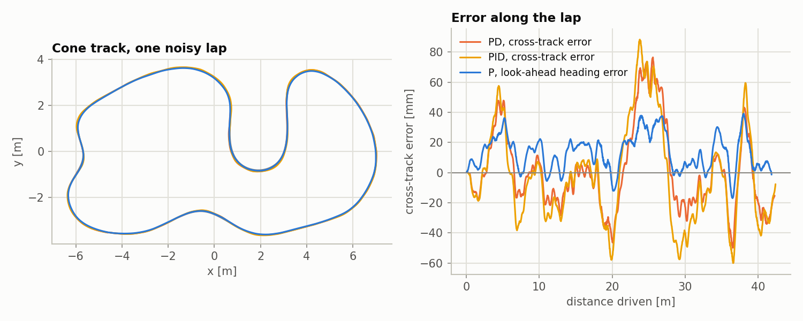

The largest errors are in the turns near 4, 24 and 36 m, for every controller: a feedback
controller has to see an error before it turns.

### 5.5 Verdict

| | Cross-track error | Look-ahead heading error |
|---|---|---|
| **P** | Unusable: oscillates and leaves the track | Best: lowest error and effort, one gain |
| **PD** | Works. Best on a twisty track | Same as P; the D term adds only effort |
| **PI** | Unusable, and slightly worse than P | Removes a steady offset on straights, adds error in turns |
| **PID** | Works. Best when a disturbance or turn lasts for seconds | Same as PI |

## 6. What each gain does

One gain of the tuned cross-track PID (kp = 3, ki = 0.25, kd = 3) is changed at a time, from
one eighth to eight times its tuned value, and everything else is held fixed.

### kp, the proportional gain

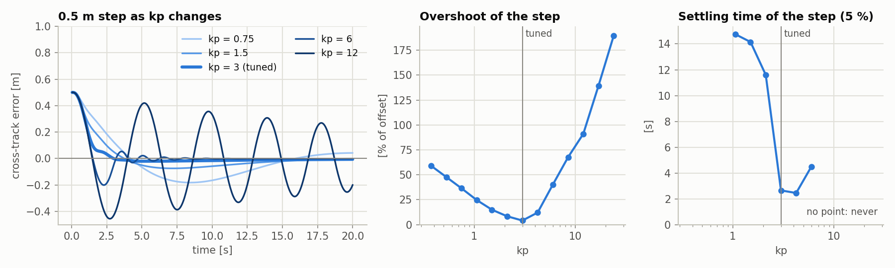

Raising kp makes the car turn toward the path harder. Up to the tuned value this helps: rise
time falls from 3.5 s to 1.65 s and overshoot from 59 % to 4 %. (The overshoot at low kp is the
integral's doing: the approach is so slow that the integral builds up before the car arrives.)
Past the tuned value the D term can no longer brake the faster approach, and the response
becomes oscillatory: 40 % overshoot at kp = 6 and no settling at kp = 12.

### ki, the integral gain

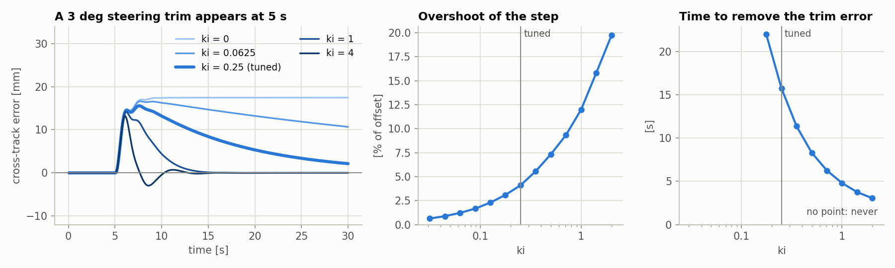

With ki = 0 the trim error stays for ever. Raising ki removes it faster: 16 s at the tuned
0.25, 8 s at ki = 0.5, 3 s at ki = 2. The price is overshoot in the step response, which grows
steadily from 0.6 % at ki = 0.03 to 20 % at ki = 2. The tuned value is the largest in the
table that keeps the step inside the 4 s settling specification, which is why the tuned PID removes a
disturbance slowly. If fast disturbance rejection mattered more than a clean step, a higher ki
would be the right choice.

### kd, the derivative gain

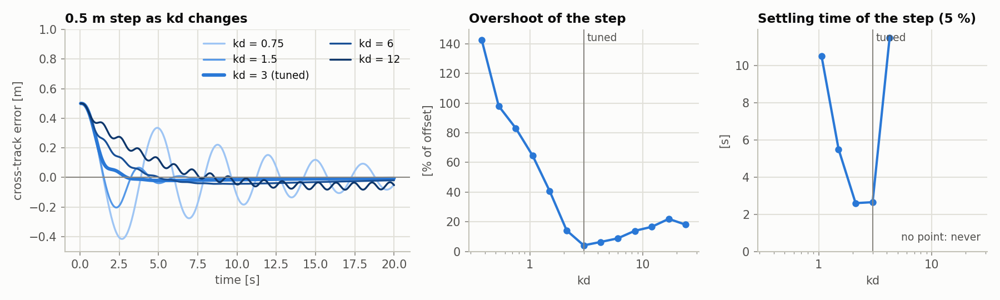

Too little kd and the car oscillates (143 % overshoot at kd = 0.375); the tuned value gives
4 %. Too much and the approach becomes slow and sticky: rise time grows from 1.65 s to 10 s at
kd = 24, and a small ripple appears on the darkest curve. There is a best value in the
middle.

### kp and kd together

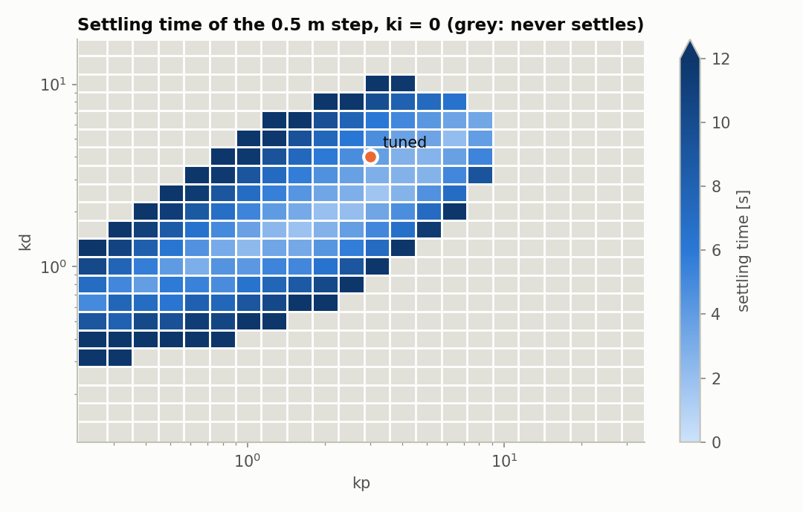

Each cell is one step response with ki = 0. The usable region is a diagonal band: more kp
needs more kd. Below the band there is not enough damping, above it the response is too slow
to settle in the 20 s test, and beyond kp of about 10 nothing settles. 69 % of the cells never
settle. The tuned PD sits inside the band.

### The same sweeps on a noisy lap

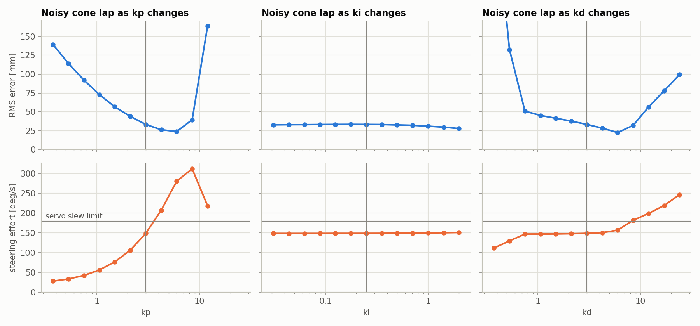

<!-- BEGIN gain_sweeps -->
| gain | value | rise time [s] | overshoot [%] | settling time [s] | time to remove trim error [s] | laps finished | lap RMS error [mm] | lap effort [deg/s] |
|---|---|---|---|---|---|---|---|---|
| kp | 0.375 | 3.50 | 59.0 | n/a | n/a | 5/5 | 139 | 28 |
| kp | 0.750 | 3.05 | 36.4 | n/a | 19.8 | 5/5 | 92 | 42 |
| kp | 1.500 | 2.50 | 14.9 | 14.15 | 12.4 | 5/5 | 57 | 77 |
| kp | 3.000 | 1.65 | 4.1 | 2.65 | 15.8 | 5/5 | 33 | 149 |
| kp | 6.000 | 0.90 | 40.2 | 4.50 | 14.0 | 5/5 | 24 | 281 |
| kp | 12.000 | 0.85 | 91.1 | n/a | n/a | 5/5 | 164 | 218 |
| kp | 24.000 | 0.85 | 189.8 | n/a | n/a | 0/5 | n/a | n/a |
| ki | 0.031 | 1.95 | 0.6 | 2.85 | n/a | 5/5 | 33 | 149 |
| ki | 0.063 | 1.90 | 1.2 | 2.80 | n/a | 5/5 | 33 | 149 |
| ki | 0.125 | 1.85 | 2.3 | 2.75 | n/a | 5/5 | 33 | 149 |
| ki | 0.250 | 1.65 | 4.1 | 2.65 | 15.8 | 5/5 | 33 | 149 |
| ki | 0.500 | 1.30 | 7.3 | 7.55 | 8.3 | 5/5 | 33 | 149 |
| ki | 1.000 | 1.15 | 12.0 | 6.85 | 4.8 | 5/5 | 31 | 150 |
| ki | 2.000 | 1.00 | 19.7 | 5.30 | 3.0 | 5/5 | 28 | 151 |
| kd | 0.375 | 0.85 | 142.7 | n/a | n/a | 1/5 | 338 | 112 |
| kd | 0.750 | 0.85 | 83.1 | n/a | n/a | 5/5 | 51 | 147 |
| kd | 1.500 | 0.90 | 40.7 | 5.50 | 15.3 | 5/5 | 41 | 147 |
| kd | 3.000 | 1.65 | 4.1 | 2.65 | 15.8 | 5/5 | 33 | 149 |
| kd | 6.000 | 3.30 | 8.8 | n/a | 16.9 | 5/5 | 22 | 157 |
| kd | 12.000 | 5.80 | 16.6 | n/a | n/a | 5/5 | 56 | 199 |
| kd | 24.000 | 10.10 | 18.0 | n/a | n/a | 5/5 | 99 | 247 |
<!-- END gain_sweeps -->

The table shows every second value of each sweep; all 13 values per gain are in
`results/gain_sweeps.csv`.

On a noisy lap, error keeps falling as kp rises to 6, but steering effort rises in proportion
because sensor noise is multiplied by kp; it crosses the servo's 180 degrees/s just above
kp = 3 (149 at kp = 3, 281 at kp = 6). That, and not stability, is what set the tuned kp. ki barely changes the lap
result (33 mm falling to 28 mm at ki = 2). Raising kd lowers the error slowly up to kd = 6
with almost no change in effort; beyond that both rise.

| Raise this gain | Gets better | Gets worse |
|---|---|---|
| kp | speed of response, steady error (halves when kp doubles), lap error | overshoot, steering effort, sensitivity to noise and delay |
| ki | time to remove a steady error | overshoot, settling time; error in turns for the look-ahead signal |
| kd | overshoot, stability | speed of response; noise if the derivative is differenced; sensitivity to delay |

## 7. Techniques that matter in practice

### 7.1 Where the derivative comes from

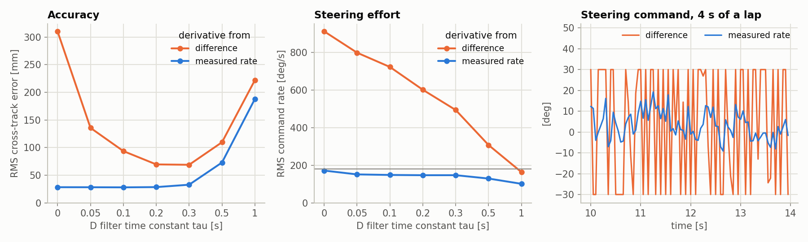

<!-- BEGIN d_term -->
| D term | laps finished | RMS error [mm] | sd | max error [mm] | effort [deg/s] | saturated [%] |
|---|---|---|---|---|---|---|
| difference, tau = 0 s | 10/10 | 310 | 17 | 751 | 911 | 88.7 |
| difference, tau = 0.05 s | 10/10 | 136 | 10 | 352 | 798 | 74.4 |
| difference, tau = 0.1 s | 10/10 | 94 | 6 | 248 | 722 | 62.1 |
| difference, tau = 0.2 s | 10/10 | 70 | 4 | 187 | 601 | 46.8 |
| difference, tau = 0.3 s | 10/10 | 69 | 3 | 198 | 493 | 41.4 |
| difference, tau = 0.5 s | 10/10 | 110 | 12 | 302 | 307 | 55.5 |
| difference, tau = 1 s | 10/10 | 222 | 8 | 530 | 163 | 74.5 |
| measured rate, tau = 0 s | 10/10 | 28 | 1 | 74 | 171 | 0.7 |
| measured rate, tau = 0.05 s | 10/10 | 28 | 1 | 74 | 151 | 0.6 |
| measured rate, tau = 0.1 s | 10/10 | 28 | 1 | 75 | 148 | 0.6 |
| measured rate, tau = 0.2 s | 10/10 | 28 | 1 | 83 | 147 | 1.1 |
| measured rate, tau = 0.3 s | 10/10 | 33 | 2 | 105 | 147 | 4.5 |
| measured rate, tau = 0.5 s | 10/10 | 73 | 4 | 210 | 129 | 39.5 |
| measured rate, tau = 1 s | 10/10 | 188 | 8 | 457 | 101 | 69.1 |
<!-- END d_term -->

The tuned PD is run with its D term computed in two ways.

*Differencing the error.* Position noise of 30 mm, differenced over 50 ms, is a rate noise of
about $\sqrt2 \times 0.03 / 0.05$ = 0.85 m/s. Multiplied by kd = 4 that is 3.4 rad, six times
the steering limit, on every sample. The right-hand panel shows the result: the command slams
between the limits. A low-pass filter helps up to a point. Error falls from 310 mm with no
filter to 69 mm at tau = 0.3 s, then rises again because a slow filter delays the D term until
it no longer damps anything. Even at its best the command is saturated 41 % of the time.

*Measuring the rate.* The rate of change of cross-track error is $-v \sin(\text{heading
error})$. Heading noise of 0.02 rad gives a rate noise of 0.012 m/s, about 70 times smaller.
The result is 28 mm with no filter and 0.7 % saturation. A light filter (tau = 0.05 to 0.2 s)
lowers the effort a little at no cost in accuracy; a heavy one hurts for the same reason as
before.

The general rule: do not differentiate a noisy signal if another sensor measures its rate
directly. A gyro for an angle and a wheel encoder for a position are the usual examples.

### 7.2 Anti-windup

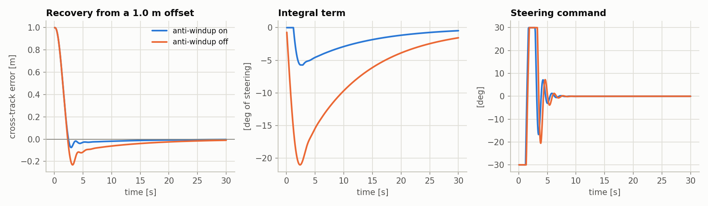

<!-- BEGIN anti_windup -->
| anti-windup | ki | overshoot [%] | settling time [s] | largest integral term [deg] | saturated [%] |
|---|---|---|---|---|---|
| on | 0.25 | 7.5 | 3.3 | 6 | 7.8 |
| off | 0.25 | 23.0 | 12.3 | 21 | 9.2 |
<!-- END anti_windup -->

Starting 1 m from the path, the steering is at its limit for most of the first three seconds,
first one way and then the other. During that time a plain integral keeps adding up a large
error it can do nothing about. When the car
reaches the path the integral is still holding 21 degrees of steering and carries the car
through to the other side, where it takes over 12 s to unwind. With anti-windup the integral
is frozen while the command is saturated, peaks at 6 degrees, and the car settles in 3.3 s.

### 7.3 Delay and actuator lag

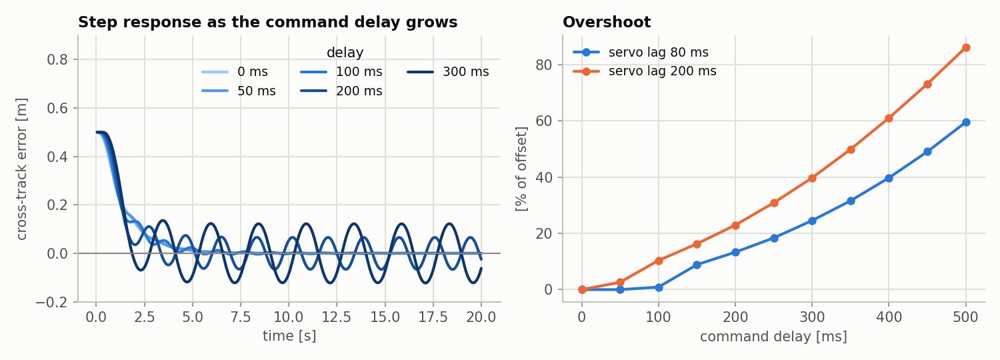

<!-- BEGIN delay -->
| delay [ms] | servo lag [s] | overshoot [%] | settling time [s] |
|---|---|---|---|
| 0 | 0.08 | 0.0 | 4.0 |
| 0 | 0.20 | 0.0 | 4.2 |
| 50 | 0.08 | 0.0 | 3.9 |
| 50 | 0.20 | 2.6 | 4.4 |
| 100 | 0.08 | 0.9 | 3.9 |
| 100 | 0.20 | 10.4 | n/a |
| 150 | 0.08 | 8.9 | n/a |
| 150 | 0.20 | 16.3 | n/a |
| 200 | 0.08 | 13.3 | n/a |
| 200 | 0.20 | 23.0 | n/a |
| 300 | 0.08 | 24.6 | n/a |
| 300 | 0.20 | 39.8 | n/a |
<!-- END delay -->

The tuned PD was designed with 50 ms of delay. It tolerates 100 ms. At 150 ms it no longer
settles and keeps a small steady oscillation, which grows with further delay. A slower servo
(200 ms lag) uses up the margin sooner, failing at 100 ms. The gains that are best for the
nominal car are close to the edge, so a real system would be tuned with some delay in hand.

## 8. Why the heading-to-waypoint controllers behaved as they did

`p_controller.py`, `pd_controller.py` and `pi_controller.py` steer on the heading to a
waypoint a short distance ahead. For a point $L_d$ ahead on a straight path, the look-ahead
angle is approximately

$$\alpha \approx \frac{1}{L_d}\left(e + \frac{L_d}{v}\,\dot e\right)$$

so a P controller $\delta = k\,\alpha$ is the same as

$$\delta = \frac{k}{L_d}\,e + \frac{k}{v}\,\dot e$$

which is a PD controller on cross-track error with $k_p = k / L_d$ and $k_d = k / v$. The
derivative comes from the car's heading, which is the measured-rate technique of section 7.1.

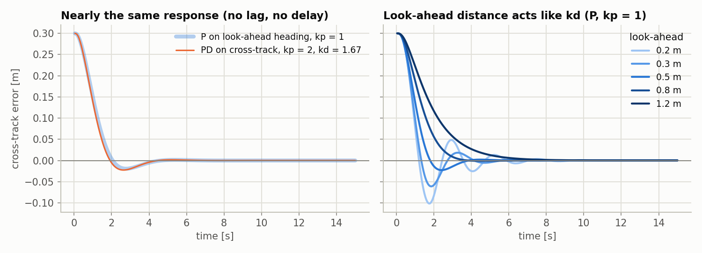

<!-- BEGIN lookahead -->
| look-ahead [m] | rise time [s] | overshoot [%] | settling time [s] |
|---|---|---|---|
| 0.2 | 0.70 | 33.9 | 4.45 |
| 0.3 | 0.80 | 20.4 | 3.60 |
| 0.5 | 1.10 | 7.6 | 3.00 |
| 0.8 | 1.85 | 0.3 | 2.80 |
| 1.2 | 3.25 | 0.0 | 4.80 |
<!-- END lookahead -->

The left panel checks the algebra: look-ahead P with k = 1 and cross-track PD with the
equivalent gains (kp = 2, kd = 1.67) give responses within 13 mm of each other. The right
panel shows that the look-ahead distance plays the part of kd: a short look-ahead (0.2 m)
overshoots 34 %, a long one (1.2 m) is slow.

That accounts for three things seen in the earlier Gazebo runs:

- **P alone tracked well,** because it already contained a derivative.
- **Adding a D term made it worse.** The heading to a point only 0.2 to 0.3 m away moves by
  several degrees when the position reading moves by 30 mm, and differencing that at 10 Hz
  gives a D term far larger than the steering limit:

  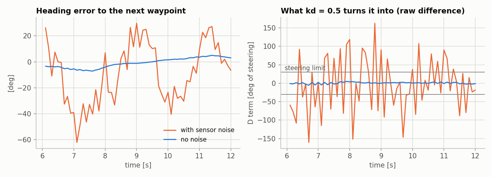

- **Adding an I term changed nothing,** because there was no steady error for it to remove,
  and on a curved track the look-ahead integral works against the turn (section 5.3).

The waypoint scheme (waypoints 0.1 m apart, switch inside 0.2 m, slow down for large errors,
10 Hz) was rebuilt in the Python model and run with the same gains as the Gazebo runs:

<!-- BEGIN waypoint -->
| controller | laps finished in 300 s | lap time [s] | mean heading error [rad] | RMS error [mm] | saturated [%] |
|---|---|---|---|---|---|
| P (kp=2) | 10/10 | 89 | 0.29 | 49 | 42 |
| PD (kd=0.5, raw D) | 1/10 | 189 | 1.42 | 308 | 83 |
| PD (kd=0.5, tau=0.3) | 9/10 | 109 | 0.55 | 103 | 56 |
| PI (ki=0.2) | 10/10 | 91 | 0.32 | 69 | 42 |
<!-- END waypoint -->

For comparison, the Gazebo runs of the actual nodes (one lap each, noise seed 7, logs in
`results/gazebo_waypoint_nodes/`):

| Node and gains | Lap time [s] | Mean heading error [rad] | Saturated [%] |
|---|---|---|---|
| `pd_controller`, kp = 2, kd = 0 (acts as P) | 95 | 0.21 | 19 |
| `pd_controller`, kp = 2, kd = 0.5 | 112 | 0.40 | 41 |
| `pi_controller`, kp = 2, ki = 0.2 | 95 | 0.21 | 18 |

The ranking is the same in both: PI matches P, raw PD is clearly worse, and filtering the D
term recovers part of the loss. The Python model is harsher on the raw PD (only 1 lap in 10
finished, where Gazebo finished its one lap), so it should be read as agreeing on direction,
not on size.

## 9. Gazebo validation

The five controllers that matter were driven round the cone track in Gazebo Classic with the
same node (`pid_controller`), the same PID class, the same gains as section 4, sensor noise
on, three seeds each. Gazebo adds what the Python model leaves out: mass, tyre contact, and
the steering and drive loops of the Ackermann plugin. It has no added steering trim.

<!-- BEGIN gazebo -->
| controller | outcome | laps finished | RMS error [mm] | sd | max error [mm] | effort [deg/s] | saturated [%] |
|---|---|---|---|---|---|---|---|
| P | stalled | 0/3 | n/a | n/a | n/a | n/a | n/a |
| PD | finished | 3/3 | 52 | 1 | 120 | 146 | 3.6 |
| PI | stalled | 0/3 | n/a | n/a | n/a | n/a | n/a |
| PID | finished | 3/3 | 59 | 1 | 149 | 144 | 3.6 |
| P look-ahead | finished | 3/3 | 51 | 1 | 124 | 103 | 0.8 |
<!-- END gazebo -->

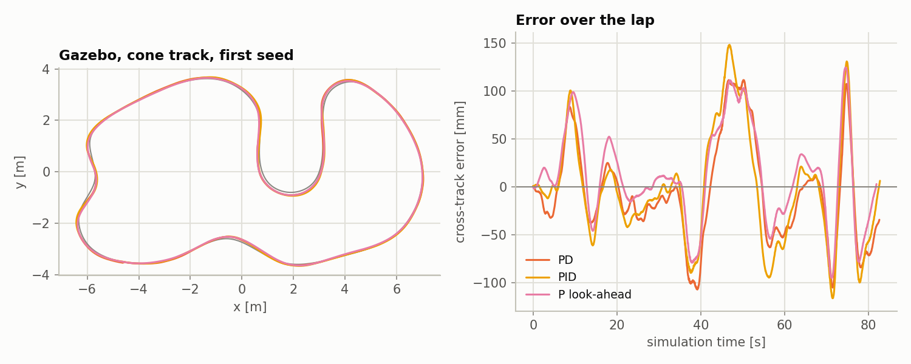

What agreed with the Python model:

- **P and PI on cross-track error did not complete a lap in any run.** The error passed 0.3 m
  between 17 and 31 s into the lap, and each run ended with the car stationary 0.4 to 1.0 m
  from the path, which the node reports as *stalled*.
- **PD, PID and look-ahead P completed all three laps.**
- **PD beat PID on this track** by 7 mm (52 against 59 mm, with 1 mm between seeds). The Python
  model had 28 against 33 mm, the same direction and nearly the same ratio.
- **Look-ahead P needed the least steering effort,** 103 degrees/s against 146 for PD.

What did not:

- **Every error was about twice as large:** 52 mm against a predicted 28 for PD, 59 against 33
  for PID, 51 against 19 for look-ahead P.
- **Look-ahead P was no more accurate than cross-track PD** (51 against 52 mm). In the Python
  model it was a third better.
- **The laps took 82 s, not the 70 s that 0.6 m/s would give.** The car averaged 0.51 m/s.

The cause of the larger errors was not investigated. The slower lap shows the plugin's speed
loop does not hold the commanded speed, and its steering loop may be similarly slower than the
80 ms servo assumed in the Python model; that would explain errors growing in the turns, but it
is a guess. The practical reading is that the Python model can be trusted for which
controllers work and how they rank, and is optimistic about absolute accuracy. Three seeds per
controller is a small sample, although the spread between seeds was only 1 mm.

## 10. Conclusions

- **Choose the error signal before choosing the controller.** The same four controllers ranked
  in opposite orders on the two signals. Look-ahead heading error builds the derivative into
  the measurement, which is why a one-gain controller was the best performer in the Python
  model and tied for best in Gazebo with the least steering effort.
- **P** is enough only when something else supplies damping. On cross-track error it is
  unstable at every gain.
- **PD** is the minimum for cross-track control and the best choice on a track whose curvature
  keeps changing.
- **PI** is never the right choice for this plant: it inherits P's instability and adds lag.
- **PID** earns its integral when a disturbance or a turn lasts for seconds: a steering
  offset, a long constant-radius bend, a slope. It needs anti-windup, and its ki is a direct
  trade between overshoot and how fast the steady error goes.
- **kp** buys speed and accuracy until noise and delay stop it, **kd** buys stability until it
  makes the response slow, **ki** buys zero steady error at the cost of overshoot.
- The implementation details decided more than the gains did: a measured rate in place of a
  differenced one cut the tracking error from 310 mm to 28 mm.

### Limitations

- The Python model is kinematic and predicted errors about half the size of those in Gazebo
  (section 9). Neither was checked against a real car.
- Tuning used a grid, so the chosen gains are the best of the values tried, not exact optima.
- Speed was constant. Cross-track dynamics scale with $v^2$, so these gains are for 0.6 m/s.
- Noise was white and independent from sample to sample. Real localisation noise is usually
  smoother, which would be kinder to a differenced D term than section 7.1 shows.
- No feedforward was used. Steering from the path's known curvature would remove most of the
  error in turns for every controller, and is the natural next step.

## How to reproduce

```bash
cd ros2_ws/src/controls_pkg
python3 -s -m pytest test/test_pid.py            # unit tests for the PID class
python3 -s -m controls_pkg.run_pid_study         # all Python experiments, figures and tables (about 1 minute)

# Gazebo validation (optional, about 20 minutes)
cd ../.. && colcon build --packages-select controls_pkg sim_pkg && source install/setup.bash
ros2 launch sim_pkg car.launch.py                # terminal 1
cd src/controls_pkg && python3 -s -m controls_pkg.run_pid_gazebo   # terminal 2
python3 -s -m controls_pkg.run_pid_study         # adds the Gazebo table and figure
```

`-s` makes Python ignore `~/.local`, where a newer NumPy conflicts with the system matplotlib.
The noise seeds are fixed, so the Python results repeat exactly.

| File | Contents |
|---|---|
| `controls_pkg/pid.py` | the PID class |
| `controls_pkg/pid_sim.py` | the realistic closed-loop simulation and the metrics |
| `controls_pkg/run_pid_study.py` | every experiment, figure and table in this report |
| `controls_pkg/pid_controller.py` | the same controller as a ROS 2 node for the Gazebo car |
| `controls_pkg/run_pid_gazebo.py` | runs the Gazebo batch |
| `test/test_pid.py` | unit tests |
| `docs/pid_study/results/` | the numbers behind every table, as CSV |
